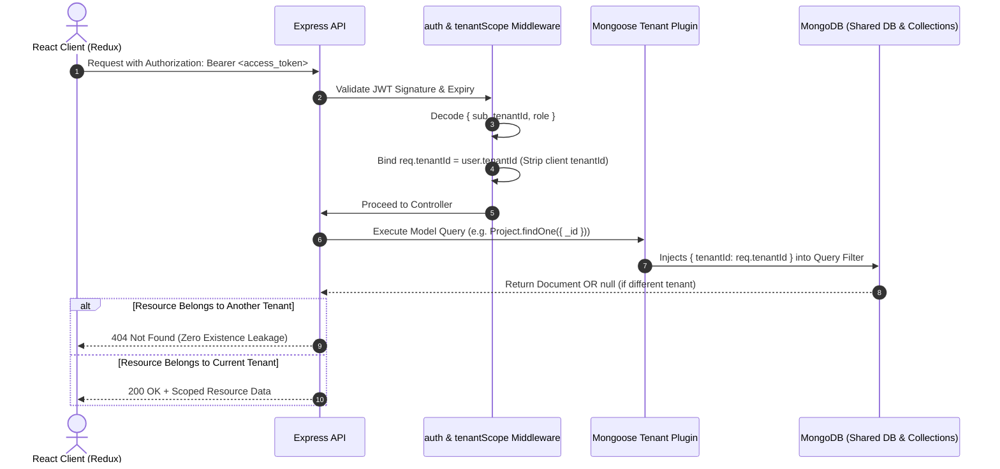
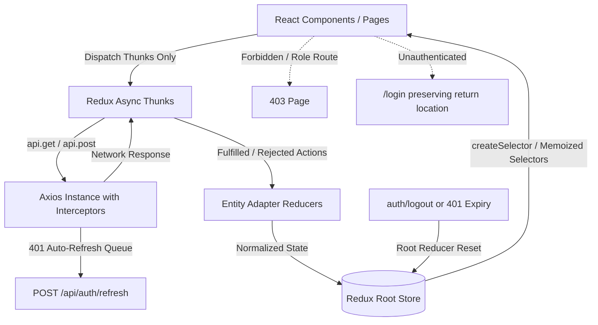

# Multi-Tenant SaaS Platform (MERN)

A production-quality, multi-tenant SaaS starter with row-level tenant isolation, dual-token JWT authentication (in-memory access tokens with httpOnly refresh token rotation), role-based access control (RBAC), and a strictly single-source-of-truth frontend state architecture built with React 18, Vite, and Redux Toolkit.

---

## 1. Architecture Overview

### Request Flow & Server-Side Tenant Isolation

Every HTTP request sent to a protected endpoint passes through a security pipeline where `tenantId` is extracted **exclusively** from the cryptographically verified JWT access token. Client inputs (`body`, `query`, `params`) can never supply or override `tenantId`.



### Frontend Single Source of Truth (SSOT) Architecture

Components **never** make direct HTTP calls and **never** duplicate server state inside component-level `useState`. All server data flows strictly through Redux Toolkit entity adapters:



---

## 2. Multi-Tenancy & Security Isolation Model

* **Architecture**: Shared Database, Shared Collections with row-level tenant partitioning via `tenantId`.
* **Zero Client Trust**: `tenantId` is **never accepted** from `req.body`, `req.query`, or `req.params`. Any client-supplied `tenantId` is unconditionally stripped by the `tenantScope` middleware.
* **Mongoose Tenant Plugin**: Applied to all tenant-scoped schemas (`User`, `Project`, `RefreshToken`). It automatically binds query helper methods (`.byTenant(tenantId)`) and injects `{ tenantId }` into query options for `find`, `findOne`, `findOneAndUpdate`, `updateOne`, `deleteMany`, and `countDocuments`.
* **Zero Existence Leakage (Strict 404)**: When Tenant A queries or attempts to modify an ID belonging to Tenant B, the query resolves to `null` on the database layer and returns **404 Not Found** (rather than 403 Forbidden). Attackers cannot probe for the existence of identifiers across tenants.
* **Compound Unique Tenant Indexing**: The `User` collection enforces uniqueness of emails per-tenant using a compound unique index:
  ```js
  userSchema.index({ tenantId: 1, email: 1 }, { unique: true });
  ```
* **Role-Based Access Control (RBAC)**:
  * `owner`: Full control over the tenant, including modifying organization profile, plan tier, and managing all users and projects.
  * `admin`: Manage tenant users (invite, edit, deactivate) and all projects.
  * `member`: Read tenant projects, create new projects, and edit projects authored by themselves. Attempting to access administrative routes returns a **403 Forbidden** page.

---

## 3. Tech Stack & Directory Structure

* **Backend**: Node.js (LTS), Express 4, MongoDB with Mongoose 8
* **Authentication**: Dual-token JWT (15-min in-memory access token + 7-day httpOnly refresh cookie rotation), bcrypt (cost factor 12)
* **Frontend**: React 18, Vite 5, React Router v6, Tailwind CSS (Mobile-First, Dark Mode)
* **State Management**: Redux Toolkit with `createEntityAdapter`, `createAsyncThunk`, and `createSelector`
* **Form & Validation**: Zod, React Hook Form with `@hookform/resolvers/zod`
* **Security**: `helmet`, `cors` (whitelisted origin with credentials), `express-mongo-sanitize`, `express-rate-limit`, `cookie-parser`
* **Testing**: Backend (Jest + Supertest + `mongodb-memory-server`), Frontend (Vitest + React Testing Library + `@testing-library/jest-dom`)

```text
multi_tenant/
├── package.json                   # Root monorepo workspace scripts
├── README.md                      # Comprehensive documentation & test guides
├── server/
│   ├── package.json
│   ├── jest.config.js
│   ├── .env.example
│   ├── .env
│   ├── src/
│   │   ├── config/                # env.js (Zod validation), db.js (Mongoose connection)
│   │   ├── models/                # Tenant, User, Project, RefreshToken, tenantPlugin
│   │   ├── middleware/            # auth, tenantScope, requireRole, validate, rateLimit, errorHandler
│   │   ├── controllers/           # auth, project, user, tenant, dashboard
│   │   ├── services/              # authService, tokenService, projectService, userService, tenantService
│   │   ├── routes/                # Express router mounts
│   │   ├── utils/                 # ApiError, asyncHandler, tokens, validationSchemas
│   │   ├── seed/                  # seed.js (Acme Corp & Globex Inc data generator)
│   │   ├── app.js                 # Express application setup
│   │   └── server.js              # Server entry point with in-memory DB fallback
│   └── tests/
│       ├── setup.js               # In-memory MongoDB lifecycle for Jest
│       ├── auth.test.js           # Authentication & token rotation tests
│       └── isolation.test.js      # Row-level tenant isolation & RBAC tests
└── client/
    ├── package.json
    ├── vite.config.js             # Vite + Vitest config with proxy
    ├── tailwind.config.js         # Design tokens, dark mode class, responsive breakpoints
    ├── postcss.config.js
    ├── index.html
    ├── .env.example
    ├── .env
    └── src/
        ├── app/                   # store.js (root reducer reset), hooks.js
        ├── api/                   # axiosInstance.js (single flight refresh queue)
        ├── features/              # Normalized slices, thunks, and memoized selectors
        │   ├── auth/              # authSlice, authThunks, selectors
        │   ├── projects/          # projectsSlice (EntityAdapter), projectsThunks, selectors
        │   ├── users/             # usersSlice (EntityAdapter), usersThunks, selectors
        │   ├── tenant/            # tenantSlice, tenantThunks, selectors
        │   ├── dashboard/         # dashboardSlice, dashboardThunks, selectors
        │   └── ui/                # uiSlice (toasts, sidebar, persistent theme)
        ├── components/            # Button, Input, Select, Textarea, Badge, Modal, ConfirmModal, Table, Card, Skeleton, EmptyState, ToastContainer, Navbar, Sidebar
        ├── layouts/               # AuthLayout, DashboardLayout
        ├── pages/                 # LoginPage, RegisterPage, DashboardPage, ProjectsPage, ProjectDetailPage, TeamPage, SettingsPage, ForbiddenPage, NotFoundPage
        ├── routes/                # ProtectedRoute, RoleRoute, PublicOnlyRoute, AppRoutes
        ├── utils/                 # validators.js, formatters.js
        └── test/                  # setup.js, authSlice.test.js, ProtectedRoute.test.jsx, integrationFlow.test.jsx
```

---

## 4. Quick Start & Prerequisites

### Prerequisites
* Node.js (v18+ LTS, v20+ or v24+ recommended)
* npm (v9+)
* Optional: Local MongoDB daemon (if not running, the application and seed scripts automatically fall back to an in-memory MongoDB instance for local demonstration).

### Step-by-Step Installation

1. **Clone and Install All Dependencies**:
   ```bash
   # From project root:
   npm run install:all
   ```

2. **Configure Environment Variables**:
   ```bash
   # Server environment:
   cp server/.env.example server/.env

   # Client environment:
   cp client/.env.example client/.env
   ```

3. **Seed Demo Tenants & Accounts**:
   ```bash
   npm run seed
   ```

4. **Run Development Servers**:
   ```bash
   # In terminal 1 (API Server on http://localhost:5000):
   npm run dev:server

   # In terminal 2 (Vite Client on http://localhost:5173):
   npm run dev:client
   ```
   Open [http://localhost:5173](http://localhost:5173) in your browser.

---

## 5. Environment Variables Reference

### Backend (`server/.env`)
| Variable | Description | Example / Default |
|---|---|---|
| `NODE_ENV` | Runtime environment (`development`, `production`, `test`) | `development` |
| `PORT` | Express HTTP server port | `5000` |
| `MONGODB_URI` | MongoDB connection URI | `mongodb://localhost:27017/multi_tenant_saas` |
| `JWT_ACCESS_SECRET` | Secret key for signing 15-minute access tokens | `super_secret_access_jwt_key_32_characters_minimum_entropy_12345` |
| `JWT_REFRESH_SECRET` | Secret key for refresh tokens | `super_secret_refresh_jwt_key_32_characters_minimum_entropy_67890` |
| `JWT_ACCESS_EXPIRES_IN` | Access token lifespan | `15m` |
| `JWT_REFRESH_EXPIRES_IN` | Refresh token lifespan | `7d` |
| `CLIENT_URL` | Whitelisted CORS origin | `http://localhost:5173` |
| `COOKIE_SECRET` | Cookie signing secret | `cookie_secret_key_needs_to_be_long_and_secure_random` |
| `BCRYPT_SALT_ROUNDS` | Bcrypt password hash salt rounds | `12` |

### Frontend (`client/.env`)
| Variable | Description | Example / Default |
|---|---|---|
| `VITE_API_URL` | Base URL for backend API | `http://localhost:5000/api` |

---

## 6. Available Scripts

| Script | Command | Description |
|---|---|---|
| `npm run install:all` | `npm --prefix server install && npm --prefix client install` | Installs dependencies in both server and client |
| `npm run seed` | `npm --prefix server run seed` | Wipes and seeds demo tenants (Acme Corp and Globex Inc) |
| `npm run test` | `npm --prefix server run test && npm --prefix client run test` | Runs complete backend (Jest) and frontend (Vitest) test suites |
| `npm run test:server` | `npm --prefix server run test` | Runs backend Jest unit & integration tests |
| `npm run test:client` | `npm --prefix client run test` | Runs frontend Vitest & React Testing Library tests |
| `npm run dev:server` | `npm --prefix server run dev` | Runs backend with nodemon hot reloading |
| `npm run dev:client` | `npm --prefix client run dev` | Runs Vite frontend development server |
| `npm run build:client` | `npm --prefix client run build` | Builds optimized production assets for the client |

---

## 7. API Reference

All protected endpoints require an `Authorization: Bearer <access_token>` header. Refresh tokens are automatically exchanged via the `refreshToken` httpOnly cookie.

| Method | Endpoint | Auth | Role | Description |
|---|---|---|---|---|
| `POST` | `/api/auth/register` | Public | None | Registers a new Tenant and its first user as `owner`. Sets refresh cookie. |
| `POST` | `/api/auth/login` | Public | None | Authenticates credentials, returns user + access token, sets refresh cookie. |
| `POST` | `/api/auth/refresh` | Cookie | None | Rotates refresh token in DB and returns a new access token. |
| `POST` | `/api/auth/logout` | Cookie | None | Revokes refresh token in DB and clears httpOnly cookie. |
| `GET` | `/api/auth/me` | Bearer | Any | Returns current user profile and tenant details. |
| `GET` | `/api/projects` | Bearer | Any | Returns paginated list of projects scoped to the caller's tenant. |
| `POST` | `/api/projects` | Bearer | Any | Creates a project scoped to the caller's tenant. |
| `GET` | `/api/projects/:id` | Bearer | Any | Returns project details (returns 404 if in another tenant). |
| `PATCH` | `/api/projects/:id` | Bearer | Member (own), Admin, Owner | Updates project. Members can only update their own projects. |
| `DELETE` | `/api/projects/:id` | Bearer | Admin, Owner | Deletes project from tenant. Members receive 403 Forbidden. |
| `GET` | `/api/users` | Bearer | Admin, Owner | Lists all team members in the caller's tenant. |
| `POST` | `/api/users` | Bearer | Admin, Owner | Creates/invites a new user inside caller's tenant. |
| `GET` | `/api/users/:id` | Bearer | Admin, Owner | Returns user details inside caller's tenant. |
| `PATCH` | `/api/users/:id` | Bearer | Admin, Owner | Updates user role or active status. |
| `DELETE` | `/api/users/:id` | Bearer | Admin, Owner | Removes user and invalidates all their active sessions. |
| `GET` | `/api/tenant` | Bearer | Any | Returns current tenant organization profile and plan. |
| `PATCH` | `/api/tenant` | Bearer | Owner Only | Updates tenant organization name and subscription tier. |
| `GET` | `/api/dashboard/stats` | Bearer | Any | Returns tenant-isolated project counters, status breakdown, and team metrics. |

---

## 8. Test Access & Reviewer Checklist

### Demo Credentials (Created by `npm run seed`)

| Tenant | Role | Email | Password | Quick-Fill Button in UI |
|---|---|---|---|---|
| **Acme Corp** | `owner` | `owner@acme.test` | `Test@1234` | Available on `/login` |
| **Acme Corp** | `admin` | `admin@acme.test` | `Test@1234` | Available on `/login` |
| **Acme Corp** | `member` | `member@acme.test` | `Test@1234` | Available on `/login` |
| **Globex Inc** | `owner` | `owner@globex.test` | `Test@1234` | Available on `/login` |
| **Globex Inc** | `member` | `member@globex.test` | `Test@1234` | Available on `/login` |

### Manual Verification Checklist (Under 5 Minutes)

1. **Tenant Isolation Verification**:
   * Open the app at `http://localhost:5173/login` and click **"Acme Owner"** quick-fill button, then click **Sign In**.
   * Navigate to **Projects** and create a project named `"Acme Super Secret Warp Core"`.
   * Open the User menu on the top right and click **Sign Out**.
   * Sign in as **Globex Owner** (`owner@globex.test`).
   * Navigate to **Projects** and observe: `"Acme Super Secret Warp Core"` is **completely absent**. Only Globex projects are listed.
2. **Direct Cross-Tenant ID Probing (Strict 404)**:
   * While logged in as Globex, attempt to navigate directly to the URL of an Acme project: `http://localhost:5173/projects/<acme_project_id>`.
   * Observe: The application returns **404 Not Found** ("Project not found"), **never 403**, proving that the resource's existence is completely shielded.
3. **Role-Based Access Control (RBAC)**:
   * Sign in as **Acme Member** (`member@acme.test`).
   * Notice that the **Team Members** and **Tenant Settings** links are hidden from the navigation sidebar.
   * Attempt to manually browse to `http://localhost:5173/team` or `http://localhost:5173/settings`.
   * Observe: The page renders the **403 Forbidden** screen detailing insufficient permissions.
4. **Single Source of Truth (Entity Adapter Live Update)**:
   * Sign in as **Acme Owner**.
   * Open **Projects** and click the **Edit** icon on any project.
   * Change its name or status (e.g. from Active to Completed) and save.
   * Navigate back to the **Dashboard**: The KPI counters and status charts reflect the update immediately without an API refetch.
5. **Silent Auth Bootstrapping (No Login Flash)**:
   * While authenticated on `/dashboard`, press `F5` / reload the browser window.
   * Observe: A smooth full-screen loading spinner appears during silent refresh token rotation, and directly renders `/dashboard` without ever flashing the `/login` screen.
6. **Store Wipe on Logout**:
   * Click **Sign Out**. The Redux root reducer reset triggers, completely purging all project entities, user lists, and tenant IDs from memory.

---

## 9. Deployment Guide

### Deploying the Backend API (Render / Railway)
1. Push repository to GitHub.
2. In [Render](https://render.com) or [Railway](https://railway.app), create a new **Web Service** pointing to the `server/` directory.
3. Set the build command: `npm install` and start command: `node src/server.js`.
4. Add environment variables:
   * `NODE_ENV=production`
   * `PORT=5000`
   * `MONGODB_URI=<your_mongodb_atlas_connection_string>`
   * `JWT_ACCESS_SECRET=<generated_high_entropy_secret_32_chars>`
   * `JWT_REFRESH_SECRET=<generated_high_entropy_secret_32_chars>`
   * `CLIENT_URL=https://your-frontend-domain.vercel.app`
   * `COOKIE_SECRET=<generated_secret>`

### Deploying the Frontend (Vercel)
1. In [Vercel](https://vercel.com), create a new project importing the repository.
2. Set the **Root Directory** to `client`.
3. Set Framework Preset to **Vite**.
4. Configure Build Command: `npm run build` and Output Directory: `dist`.
5. Add Environment Variable:
   * `VITE_API_URL=https://your-backend-api.onrender.com/api`

### Database (MongoDB Atlas)
1. Create a free shared cluster on [MongoDB Atlas](https://www.mongodb.com/atlas).
2. Create a database user with read/write access.
3. Whitelist `0.0.0.0/0` (or the IP range of your hosting provider).
4. Copy the SRV URI into `MONGODB_URI`.
